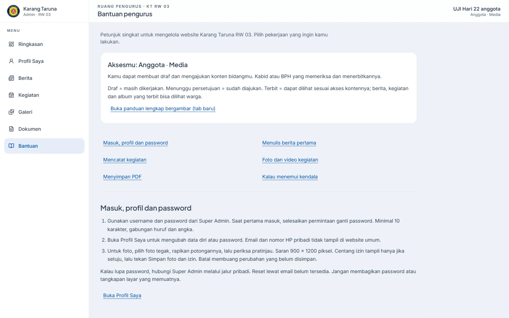
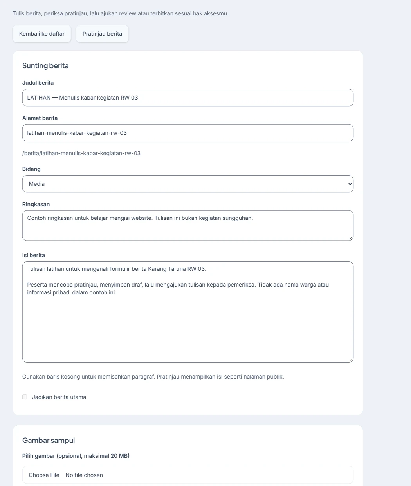
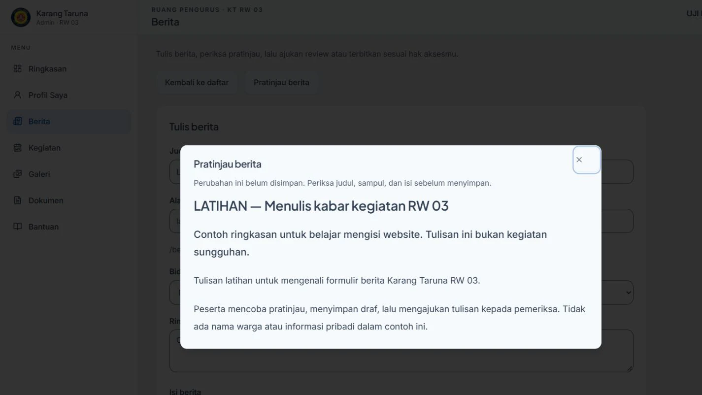
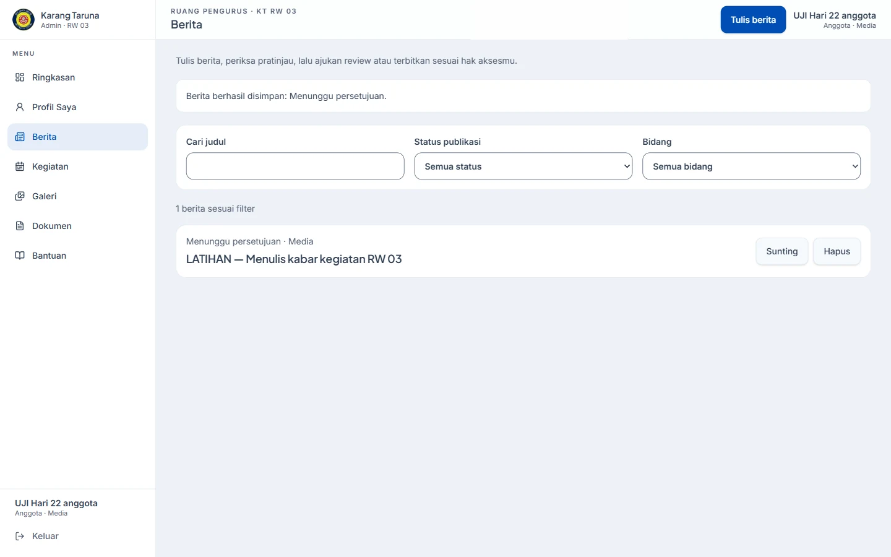
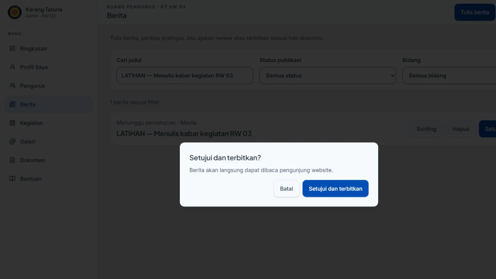

# Panduan pengurus website Karang Taruna RW 03 Cipedak

Panduan ini untuk pengurus yang mengisi website, termasuk yang baru pertama mencoba. Buka website di **https://ukkt03cipedak.pages.dev**, lalu pilih ikon **Masuk pengurus**. Bantuan singkat juga tersedia lewat menu **Bantuan** setelah masuk.

Gambar di bawah memakai akun dan tulisan latihan. Nama/file latihan bukan data organisasi, dan tidak memuat password atau kontak pribadi. Panduan diperiksa terhadap aplikasi Hari 22, 20 Oktober 2026.

## Mau melakukan apa?

- [Masuk dan mengenali menu](#1-masuk-dan-mengenali-menu)
- [Menulis berita pertama](#2-menulis-berita-pertama)
- [Mencatat kegiatan](#3-mencatat-kegiatan)
- [Mengisi album foto/video](#4-mengisi-album-fotovideo)
- [Menyimpan dokumen PDF](#5-menyimpan-dokumen-pdf)
- [Profil sendiri dan izin foto](#6-profil-sendiri-dan-izin-foto)
- [Memeriksa pengajuan — Kabid/BPH](#7-memeriksa-pengajuan--kabidbph)
- [Data pengurus, pengaturan dan log — BPH](#8-data-pengurus-pengaturan-dan-log--bph)
- [Akun — Super Admin](#9-akun--super-admin)
- [Kalau ada kendala](#10-kalau-ada-kendala)
- [Lembar uji mandiri](#11-lembar-uji-mandiri)

## 1. Masuk dan mengenali menu

1. Minta **username** dan password awal kepada Super Admin lewat chat pribadi. Tidak ada pendaftaran akun untuk warga.
2. Buka **Masuk pengurus**, isi keduanya, lalu masuk. Jangan membagikan password atau screenshot halaman yang berisi password.
3. Jika diminta mengganti password awal, lakukan dahulu. Password minimal **10 karakter, gabungan huruf dan angka**. Simpan dengan aman untuk diri sendiri.
4. Di komputer, menu ada di kiri. Di HP/tablet, tekan tombol **Buka menu** di kiri atas. Buka **Bantuan** jika butuh petunjuk.

Menu setiap orang bisa berbeda, sesuai tugasnya:

| Peran                                   | Yang dapat dilakukan                                                                       |
| --------------------------------------- | ------------------------------------------------------------------------------------------ |
| Anggota/Penasihat tanpa izin kontribusi | Membaca informasi dan mengubah profil sendiri                                              |
| Anggota yang diberi izin kontribusi     | Membuat dan menyunting draf miliknya di bidang sendiri, lalu mengajukannya untuk diperiksa |
| Kepala Bidang (Admin Level 2)           | Mengelola konten dan izin anggota bidangnya, termasuk memeriksa/menerbitkan konten         |
| BPH (Admin Level 1)                     | Mengelola semua bidang, data pengurus, pengaturan dan log aktivitas                        |
| Super Admin                             | Hak pengelolaan menyeluruh, termasuk menu Akun                                             |

Jika menu Berita/Kegiatan/Galeri belum ada, **minta Kabid atau BPH memberi izin kontribusi**. Jangan meminjam akun orang lain. Setelah izin diberikan, muat ulang halaman.

Tiga status yang perlu dikenali:

| Status                   | Artinya                                                                                                                            |
| ------------------------ | ---------------------------------------------------------------------------------------------------------------------------------- |
| **Draf**                 | Tulisan masih disiapkan; belum ditampilkan kepada warga                                                                            |
| **Menunggu persetujuan** | Sudah diajukan untuk diperiksa Kabid/BPH; belum tampil kepada warga                                                                |
| **Terbit**               | Sudah tersedia sesuai akses kontennya. Berita, kegiatan dan album terbit dapat dilihat warga; PDF tetap mengikuti pilihan aksesnya |

**Belum ada simpan otomatis.** Tunggu pesan berhasil setelah menekan Simpan. Kalau hendak meninggalkan isian yang belum disimpan, baca pilihan pada peringatan dengan teliti.

## 2. Menulis berita pertama

Siapkan judul, ringkasan, isi kejadian dan foto yang sudah diizinkan. Berita latihan tidak boleh diterbitkan di website umum tanpa kesepakatan penanggung jawab.

1. Buka **Berita**, lalu **Tulis berita**.
2. Isi **Judul berita**. **Alamat berita** terisi mengikuti judul; biarkan jika sudah sesuai. Jika alamat sudah dipakai, ubah sedikit agar berbeda.
3. Pastikan **Bidang** benar. Isi **Ringkasan** dan **Isi berita**. Pisahkan paragraf dengan satu baris kosong. Tulis fakta: kegiatan apa, kapan, di mana dan siapa penyelenggaranya. Jangan mengarang jumlah peserta atau hasil kegiatan.

4. Sampul boleh dikosongkan saat latihan. Jika memakai foto: pilih **JPG/PNG/WebP, maksimal 20 MB**. Gambar mendatar **1200 × 630 piksel** disarankan. Tulis **Keterangan foto**, dan periksa bahwa foto boleh ditampilkan untuk umum.
5. Tekan **Pratinjau berita**. Periksa isi dan tampilannya. Tutup pratinjau untuk kembali ke formulir.

6. Tekan **Simpan draf**. Pastikan ada pesan berhasil dan status **Draf** pada daftar berita. Untuk melanjutkan, cari judulnya lalu tekan **Sunting**.
7. Kalau sudah siap diperiksa, tekan **Ajukan review**. Ringkasan dan isi wajib terisi. Pastikan status berubah menjadi **Menunggu persetujuan**, kemudian kabari Kabid/BPH melalui jalur tim.

**Untuk anggota:** tugasmu sampai pengajuan. Kabid/BPH yang memeriksa dan menerbitkan. Jika dikembalikan menjadi Draf, perbaiki sesuai catatan pemeriksa lalu ajukan lagi. Website belum menyediakan kolom percakapan pemeriksa; sampaikan catatan lewat jalur tim.

**Membatalkan:** gunakan **Kembali ke daftar**, lalu pilih apakah ingin tetap menyunting atau membuang isian yang belum disimpan. Membuang isian tidak menghapus draf yang sebelumnya sudah tersimpan. Jangan menekan Hapus jika hanya ingin menutup formulir.

## 3. Mencatat kegiatan

1. Buka **Kegiatan → Tambah kegiatan**.
2. Isi judul, bidang, keterangan, lokasi dan jadwal sesuai acara. Jika kegiatan berulang, isi keterangan perulangannya. Periksa tanggal dan jam WIB; jangan menebak tanggal yang belum ditetapkan.
3. **Tahap kegiatan** menjelaskan pelaksanaannya: Rencana/Berjalan/Selesai/Batal. Ini berbeda dari status Draf/Menunggu persetujuan/Terbit yang mengatur penayangannya.
4. Tekan **Simpan draf** untuk dilanjutkan nanti, atau **Ajukan persetujuan** untuk diperiksa. Kabid/BPH menggunakan **Terbitkan kegiatan** jika sudah siap.
5. Setelah diterbitkan, buka halaman Kegiatan pada website umum dan pastikan informasi benar. Jangan menganggap memilih tahap Selesai otomatis menerbitkan kegiatan.

## 4. Mengisi album foto/video

### Jika foto asli masih di Google Drive

1. Tim memilih foto yang boleh dipublikasikan dari folder arsip. Gunakan [checklist foto awal](CHECKLIST-FOTO-LAUNCH.md) agar kebutuhan foto jelas.
2. Unduh **foto pilihan saja** ke HP/komputer. Kalau unduhan berbentuk ZIP, keluarkan isinya dahulu.
3. Unggah file foto/video melalui Galeri di website. Setelah benar-benar tersimpan dan diperiksa, salinan unduhan sementara di perangkat boleh dibersihkan; master di Drive tetap disimpan.

**Tautan Drive tidak mengimpor foto.** Kolom tautan folder hanya mengarahkan pengunjung ke foto asli. Jangan menautkan folder induk yang juga berisi data internal. Jangan mengubah akses folder menjadi terbuka hanya supaya formulir bisa disimpan; tanyakan pemilik arsip dahulu.

### Membuat dan mengisi album

1. Buka **Galeri → Album baru**. Isi judul, tanggal dokumentasi, deskripsi dan bidang, lalu **Simpan draf** dahulu.
2. Pilih file dari perangkat. Batasnya **40 file sekali pilih**, **200 media per album**. Foto JPG/PNG/WebP maksimal **20 MB per file**; video maksimal **200 MB**. MP4/WebM disarankan agar mudah diputar. Foto diringankan otomatis oleh website.
3. Tekan **Mulai / lanjutkan unggahan** dan tunggu sampai file tersimpan. Biarkan tab terbuka.
4. Isi **Keterangan**, gunakan **Naik/Turun** untuk mengurutkan, dan **Jadikan sampul** pada foto yang paling mewakili kegiatan. Foto pertama otomatis menjadi sampul awal.
5. Video YouTube/Instagram/TikTok bisa dimasukkan lewat **Video dari tautan → Tambahkan video**. Periksa bahwa tautannya benar dan kontennya boleh ditampilkan.
6. Jika memakai **Tautan folder foto asli di Google Drive**, pastikan isi serta izin folder aman bagi publik. Tautan akan tampil saat album diterbitkan.
7. Pilih **Status publikasi → Menunggu persetujuan**, lalu simpan. Kabid/BPH memeriksa sebelum memilih **Terbit** dan menyimpan.

### Jika unggahan terhenti

- Koneksi putus: biarkan tab terbuka; antrean dilanjutkan saat koneksi pulih.
- Ingin berhenti sementara: tekan **Jeda**. Untuk meneruskan, tekan **Mulai / lanjutkan unggahan**.
- Tab terlanjur tertutup: buka album yang sama dan pilih ulang file yang sama; file yang sudah tersimpan tidak digandakan.
- **Kosongkan antrean** mengosongkan daftar kerja pada tab, bukan menghapus media yang sudah tersimpan.
- **Bersihkan unggahan tertunda** membatalkan pekerjaan yang belum selesai dan membersihkan file sementaranya. Jangan jalankan saat unggahan masih berjalan di tab lain.
- Album sudah terbit: ubah menjadi **Draf**, simpan dahulu, baru sunting isinya. Album sementara tidak tersedia untuk warga sampai diterbitkan kembali.

Hindari close-up wajah anak dan foto yang tidak mendapat izin. Untuk beranda, jangan gunakan foto berlatar kampanye/tokoh politik. Foto yang diunggah ke album **tidak otomatis mengisi empat foto beranda**.

## 5. Menyimpan dokumen PDF

1. Buka **Dokumen** dan tambah dokumen. Isi judul, kategori, tahun, tanggal serta bidang sesuai berkas.
2. Pilih **PDF maksimal 20 MB**. Periksa pratinjau: halaman benar, teks terbaca, tidak ada lampiran atau data pribadi yang salah ikut.
3. Tentukan akses dengan teliti:

| Akses       | Untuk siapa?                                               |
| ----------- | ---------------------------------------------------------- |
| **Publik**  | Pengunjung umum ketika dokumen sudah terbit                |
| **Anggota** | Pengurus yang masuk dengan akun aktif dan berhak mengakses |
| **BPH**     | BPH/Super Admin yang berhak                                |

Pilihan yang tersedia mengikuti akunmu. **Status Terbit tidak mengubah PDF internal menjadi publik.** Jika ragu menentukan akses, simpan Draf dan minta BPH memeriksa. Jangan mengunggah daftar password atau identitas pribadi sebagai dokumen publik.

4. Pilih status sesuai tahapnya, lalu **Simpan dokumen**. Anggota mengajukan untuk diperiksa; Kabid/BPH menerbitkan sesuai jangkauannya.
5. Penggantian/hapus berkas mengubah dokumen pada website, bukan salinan yang sudah diunduh orang lain. Jika pesan menyebut berkas lama sudah terhapus tetapi penyimpanan gagal, muat ulang dan unggah ulang sesuai petunjuk; jangan menganggap versi lama masih ada.

## 6. Profil sendiri dan izin foto

1. Buka **Profil Saya**. Nama tampilan, email pribadi dan nomor HP diubah melalui **Data diri → Simpan**. Nama resmi/jabatan/bidang pada direktori pengurus dikelola BPH terpisah.
2. Email/nomor HP pribadi tidak ditampilkan di website umum. Akses internal dibatasi untuk diri sendiri, Kabid bidangnya dan BPH/Super Admin.
3. Untuk foto, pilih foto tegak dengan wajah jelas. Saran **900 × 1200 piksel** atau lebih. Atur potongan foto dan periksa pratinjau potret serta avatar.
4. Centang **Saya mengizinkan foto ini tampil di website untuk umum** hanya jika setuju. Tekan **Simpan foto dan izin**. Memilih foto atau merapikan potongan saja belum menyimpan.
5. **Batal** membuang perubahan foto/izin yang belum disimpan. Untuk mencabut izin yang sudah tersimpan, hilangkan centang lalu simpan.

Penggantian/pencabutan menghapus berkas foto lama. Salinan yang sudah diunduh atau tersimpan sementara pada perangkat orang lain tidak dapat ditarik kembali. Akun yang belum terhubung ke data pengurus belum bisa memasang foto direktori; hubungi BPH.

Untuk ganti password, isi **Password baru** dan **Ulangi**, lalu **Ganti password**. Jika lupa password untuk masuk, hubungi Super Admin melalui chat pribadi. Pemulihan mandiri lewat email belum tersedia.

## 7. Memeriksa pengajuan — Kabid/BPH

1. Buka daftar berita/kegiatan/album, cari status **Menunggu persetujuan**. Kabid memeriksa bidangnya; BPH/Super Admin dapat lintas bidang.
2. Periksa isi, tanggal, nama, bidang, foto/izin dan tautan. Untuk PDF, periksa aksesnya juga.
3. Berita: pilih **Setujui**, baca konfirmasi, lalu **Setujui dan terbitkan**. **Tolak** mengembalikan pengajuan ke Draf. Sampaikan alasan/koreksi kepada penulis lewat jalur tim.
4. Kegiatan: buka **Sunting** lalu **Terbitkan kegiatan**. Album: pilih **Terbit** pada Status publikasi lalu simpan. Dokumen: pilih status yang benar lalu **Simpan dokumen**.
5. Cek hasil melalui halaman publik. Jangan menerbitkan tulisan latihan atau data yang belum disepakati.

Untuk memberi izin kontribusi: buka **Pengurus**, cari anggota yang benar, lalu **Beri izin**. **Cabut izin** menghentikan izin kontribusi anggota tersebut. Kabid hanya mengatur anggota bidang sendiri; BPH/Super Admin lintas bidang. Izin ini tidak menjadikan anggota penerbit atau admin.

## 8. Data pengurus, pengaturan dan log — BPH

**Data pengurus:** gunakan pengelolaan data pengurus untuk nama resmi, gelar, jabatan, bidang, periode, status aktif dan izin foto/Instagram. Pastikan perubahan jabatan disetujui organisasi: hak akun terkait mengikuti jabatan. Menonaktifkan pengurus juga menonaktifkan akun terkait. Mengaktifkan data kembali **tidak otomatis membuka akun**, dan menambah pengurus **tidak otomatis membuat akun login**. Akun/pengurus asli tidak boleh diubah hanya untuk latihan.

**Pengaturan:** ubah kontak resmi, alamat/peta, media sosial, kalimat beranda, pengumuman, logo atau empat foto beranda. Isian kosong tertentu menyembunyikan bagian terkait. Pengumuman memiliki tanggal terakhir tampil berdasarkan WIB.

1. Siapkan gambar JPG/PNG/WebP maksimal **10 MB**. Logo persegi minimal **512 × 512 piksel**. Foto beranda minimal **800 × 600**, disarankan **1600 × 1200 piksel**, mendatar 4:3.
2. Pilih gambar dan periksa pratinjau serta susunan empat foto.
3. Tekan **Simpan pengaturan**, periksa konfirmasi, lalu lanjutkan penyimpanan jika benar. Perubahan memengaruhi website umum.
4. **Batalkan perubahan** mengembalikan isian yang belum disimpan. **Bersihkan berkas lama** dipakai untuk mencoba membersihkan berkas lama/tertunda; ikuti pesan hasilnya, bukan menghapus file aktif secara manual.
5. Muat ulang halaman publik dan cek kontak/foto/pengumuman. Pengunjung dengan halaman yang sudah terbuka mungkin perlu menyegarkan halaman.

**Log aktivitas:** buka **Log aktivitas**, gunakan filter modul, tindakan, pelaku dan tanggal, lalu **Terapkan filter**. Waktu menggunakan WIB. Log membantu menelusuri perubahan, bukan membatalkan perubahan otomatis; password dan nilai pribadi tidak ditampilkan.

## 9. Akun — Super Admin

Menu **Akun** untuk mengganti username, mereset password, atau menonaktifkan/mengaktifkan akun. Cari orang yang benar dan periksa lagi sebelum menekan konfirmasi.

- Ganti username: beri tahu pemilik akun bahwa nama untuk masuk berubah.
- Reset password: password sementara tampil **sekali**. Sampaikan langsung melalui jalur pribadi; jangan screenshot atau kirim ke grup. Pemilik akan diminta mengganti password.
- Nonaktifkan akun: orang itu tidak bisa masuk; kontennya tetap ada. Aktifkan kembali hanya setelah dipastikan berhak.
- Peran mengikuti jabatan pada data pengurus. Untuk akun pengurus baru, hubungi penanggung jawab teknis; halaman ini belum menyediakan tombol buat akun baru.

## 10. Kalau ada kendala

| Kejadian                            | Langkah yang bisa dicoba                                                                                                       |
| ----------------------------------- | ------------------------------------------------------------------------------------------------------------------------------ |
| Tidak bisa masuk                    | Periksa username/password. Setelah 5 kegagalan, tunggu 60 detik. Jika lupa password, hubungi Super Admin; jangan terus menebak |
| Menu tidak ada                      | Periksa akun/peran, minta Kabid/BPH mengecek izin kontribusi, lalu muat ulang                                                  |
| Ada isian ditandai                  | Baca pesannya, perbaiki bagian itu, lalu simpan lagi                                                                           |
| Gagal menyimpan karena koneksi      | Salin teks ke catatan pribadi, pulihkan koneksi, lalu cek daftar apakah perubahan sudah tersimpan sebelum mencoba lagi         |
| Data sudah diubah orang lain        | Simpan teks yang belum tersimpan di catatan pribadi, muat ulang, cocokkan versi terbaru dan lakukan perubahan lagi             |
| Foto/video gagal diunggah           | Periksa format, ukuran dan koneksi; gunakan langkah lanjutkan unggahan di bagian album                                         |
| Tidak terlihat pada halaman umum    | Pastikan Terbit, bidang/filter benar, lalu segarkan halaman. PDF internal memang tidak tampil untuk warga                      |
| Tidak sengaja meninggalkan formulir | Jika belum disimpan, isian mungkin hilang. Cari draf terakhir di daftar; belum ada simpan otomatis                             |

Saat melapor, tulis **menu, langkah yang dilakukan, waktu dan pesan kesalahan**. Screenshot boleh bila password, kontak pribadi dan dokumen internal sudah ditutup. Kirim ke Kabid/BPH atau penanggung jawab website melalui jalur pribadi. Jangan unggah laporan yang memuat data pribadi ke tempat publik.

## 11. Lembar uji mandiri

Hanif meminta **satu anggota Bidang Media yang belum pernah memakai admin** mencoba panduan tanpa arahan langkah demi langkah. Kabid/BPH memastikan akunnya aktif dan izin kontribusinya tersedia terlebih dahulu.

Tugas peserta:

1. Masuk dengan akun sendiri dan selesaikan ganti password bila diminta.
2. Temukan Bantuan, lalu buat berita bertanda **LATIHAN — jangan diterbitkan** memakai isi rekaan tanpa data pribadi.
3. Buka pratinjau, simpan Draf, keluar dari formulir, lalu temukan dan sunting draf itu lagi.
4. Ajukan review, lalu pastikan status Menunggu persetujuan. Kabari pemeriksa.
5. Kabid/BPH memeriksa pengajuan dan mengembalikannya ke Draf untuk dibersihkan. Jangan menerbitkan latihan kepada warga. Penerbitan nyata memakai konten yang sudah disepakati organisasi.

Catat hasil di catatan tim **privat**, memakai format:

| Yang dicatat                                     | Isi                                       |
| ------------------------------------------------ | ----------------------------------------- |
| Tanggal, perangkat/browser                       | …                                         |
| Pengalaman peserta                               | Belum pernah memakai admin / sudah pernah |
| Sampai langkah mana tanpa bantuan                | …                                         |
| Kalimat/tombol yang membingungkan                | …                                         |
| Pesan gagal yang muncul, tanpa rahasia           | …                                         |
| Perlu arahan tambahan? Di langkah mana?          | …                                         |
| Pemeriksa menerima pengajuan?                    | …                                         |
| Draf latihan sudah dibersihkan oleh yang berhak? | …                                         |

**Lulus uji mandiri** jika peserta bisa membuat, menemukan kembali, dan mengajukan berita hanya dari panduan, serta pemeriksa yang berhak bisa meninjaunya. Jika peserta butuh dibimbing, catat bagiannya dan perbaiki panduan dahulu. Hasil uji teknis dari developer tidak menggantikan uji manusia ini.

Untuk pelaksanaan beberapa hari bersama pengurus, gunakan
[panduan uji coba dan format catatan tim](UJI-COBA-PENGURUS.md). Simpan hasil yang berisi nama
peserta atau tangkapan layar pada catatan khusus tim, bukan pada repo publik ini.
